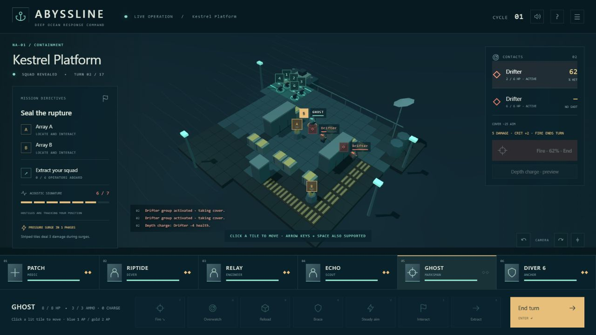

# ABYSSLINE

**Command six specialists through a deep-ocean containment crisis.** Choose which regions to protect, complete turn-based operations, and bring your team home before the ocean overwhelms the network.

Version **0.2.1** is a playable single-player prototype with a complete campaign, six regular mission types, and a final descent. It runs locally in a desktop browser with WebGL. A mouse and keyboard are recommended.


*Screenshot from v0.2; some interface details have changed.*

## Play in three steps

1. [Download the repository ZIP](https://github.com/canadianbaconking-collab/Abyssline/archive/refs/heads/main.zip) and extract it.
2. Open **ABYSSLINE.html** from the extracted folder in your browser. No installation, account, or internet connection is required to play.
3. Follow [Your first operation](docs/guides/first-operation.md): start research, deploy to North Atlantic, seal both valves, and extract your operators.

The GitHub file page displays source code; download the game before opening it. If the scene cannot render, enable browser hardware acceleration and check WebGL support.

## What you do

At **Command**, spend Material on equipment, recruits, or emergency containment. Spend Signal on research. Choose a region: helping one gives the others time to deteriorate.

In an **operation**, each specialist has two action points. Move into position, use cover and class abilities, secure the objective, then return to the green extraction zone. Enemy reinforcements continue arriving; eliminating every hostile is unnecessary.

Back at **Command**, recover from injuries, develop veterans, and respond to regional threats. Complete two foundational research projects, finish Deep coordinates, and win three operations to unlock the final descent.

**Extraction is individual.** Each operator must reach the green zone and use **Extract**. A completed objective and one survivor can earn a victory while the rest of the squad is lost.

## Find what you need

| I want to… | Read |
|---|---|
| Learn while playing my first mission | [First operation](docs/guides/first-operation.md) |
| Look up controls, classes, missions, or campaign rules | [Player guide](docs/guides/player-guide.md) |
| Save my campaign or solve a launch problem | [Saves and troubleshooting](docs/guides/player-guide.md#saves-and-troubleshooting) |
| Run, test, or change the game | [Development guide](docs/development.md) |
| Understand the design and possible next steps | [Design notes](WOTC-REVISION.md) |
| Browse reports, PDFs, and project history | [Documentation index](docs/README.md) |

## Keep your campaign

The game autosaves in your browser. Use **☰ → Export save file** for a portable backup, then **Import save file** to restore it. Browser storage can differ between a downloaded file, another browser, and a local server. Export before switching or starting a new campaign.

## Run the source

For development, use Node.js; there are no npm dependencies to install. From PowerShell:

```powershell
Set-Location -LiteralPath 'C:\dev\playground'
git clone https://github.com/canadianbaconking-collab/Abyssline.git abyssline
Set-Location -LiteralPath '.\abyssline'
node server.mjs
```

Open [http://127.0.0.1:4173](http://127.0.0.1:4173). If you already have a checkout, skip the clone and use the [development commands](docs/development.md#daily-workflow).

## Project scope

The prototype uses procedural low-poly environments, two enemy archetypes, and short replayable campaigns. It includes concealment, directional cover, class upgrades, bonds, injuries, and permanent losses. Healthy operators can deploy repeatedly; there is no fatigue mechanic.

The game uses no accounts, analytics, external services, or paid assets. Three.js r169 is bundled with its [MIT license](vendor/THREE-LICENSE.txt).
